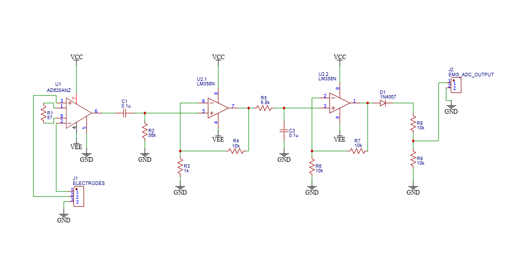
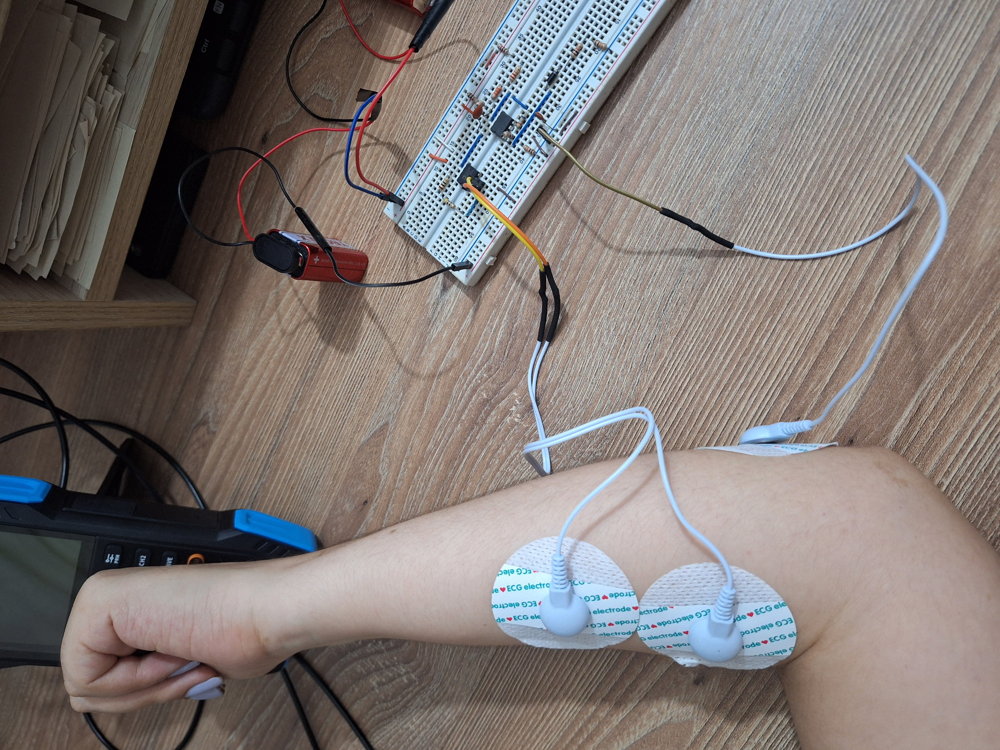
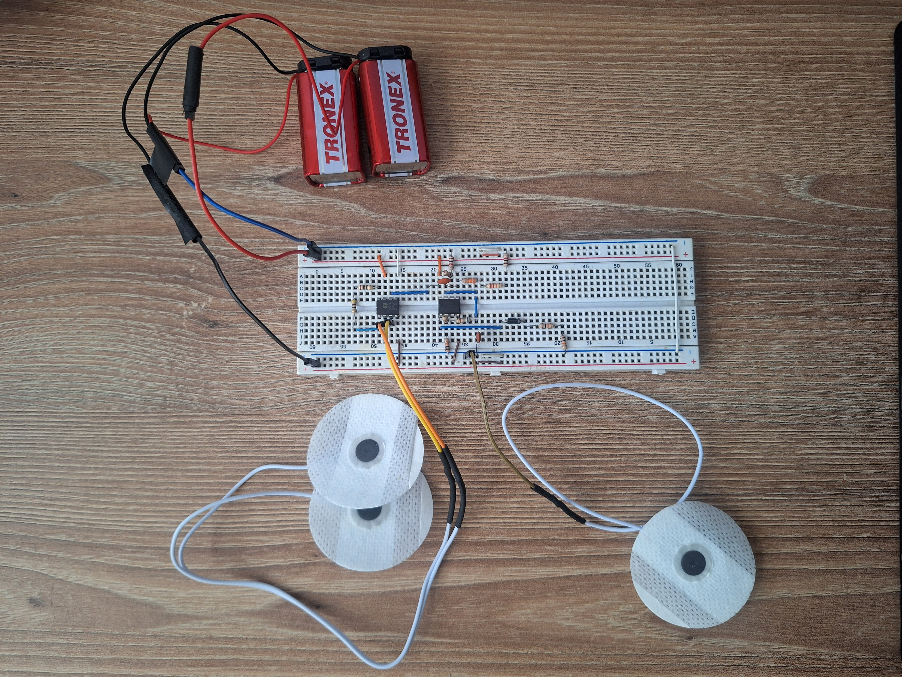

# Hardware
This section documents the hardware developed for the surface EMG acquisition system.

## Current system

The current prototype is a surface EMG acquisition system designed to capture the electrical activity generated by forearm muscles during voluntary contraction.

The system consists of surface electrodes, an instrumentation amplifier, analog filtering stages, and a microcontroller-based data acquisition stage.

The acquired signal is currently monitored using an Arduino-based acquisition system and an oscilloscope for hardware validation.

### Circuit schematic

The following schematic represents the current hardware implementation (v0.1).

## Signal acquisition

The surface EMG signal is acquired using a differential configuration. The voltage difference between two electrodes placed over the forearm muscle is provided to the differential inputs of the instrumentation amplifier.

## Electrode configuration

Two electrodes were placed over a forearm muscle to record the differential EMG signal. A third electrode was placed near the elbow and connected to the circuit ground.

## Instrumentation amplifier

The AD620 instrumentation amplifier is used as the first amplification stage. The two surface electrodes are connected to its differential inputs, while a 57 Ω resistor is used to set the amplifier gain.

The gain of the AD620 is determined by the external gain resistor:

$$
G = 1 + \frac{49.4\,k\Omega}{R_G}
$$

For the prototype, $R_G = 57\,\Omega$, resulting in:

$$
G = 1 + \frac{49.4\,k\Omega}{57\,\Omega} \approx 868
$$

## Analog filtering

## Power supply

The prototype is powered by two 9 V batteries configured as a bipolar supply. The circuit uses VCC, VEE, and GND as the positive supply, negative supply, and common reference, respectively.

## Hardware validation

A breadboard prototype was assembled and experimentally tested to verify the signal acquisition and conditioning stages.

