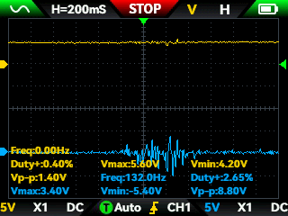

# Amplification

## Objective

This experiment was performed to evaluate the signal amplitude at different stages of the analog front-end during voluntary forearm muscle contraction.

## Measurement setup 

The same electrode configuration described in the [hardware documentation](../../README.md) was used for this experiment.

The AD620 output was connected to channel 1 of the oscilloscope, while the output of the first LM358 stage (U2.1) was connected to channel 2.

Measurements were performed during voluntary forearm muscle contraction.

## Experimental conditions

- Prototype: v0.1
- Circuit assembly: breadboard
- Power supply: two 9 V batteries configured as a bipolar supply
- Measurement instrument: FNIRSI 2C53T oscilloscope
- Time scale: 200 ms/div
- Voltage scale: 5 V/div
- Channel coupling: DC (CH1 and CH2)
- Electrode configuration: two recording electrodes + one reference electrode
- Muscle location: forearm
- Number of trials: 5

## Results

| Trial | AD620 Vmax (V)| AD620 Vmin (V) | AD620 Vpp (V) | LM358 Vmax (V) | LM358 Vmin (V) | LM358 Vpp (V) |
|---:|---:|---:|---:|---:|---:|---:|
| 1 | 5.6 | 4.2 | 1.4 | 3.4 | -5.4 | 8.8 |
| 2 | 5.6 | 4.0 | 1.6 | 5.0 | -6.8 | 11.8 |
| 3 | 4.8 | 4.0 | 0.8 | 3.6 | -6.6 | 10.2 |
| 4 | 4.8 | 3.6 | 1.2 | 4.2 | -5.4 | 9.6 |
| 5 | 4.0 | 2.4 | 1.6 | 5.6 | -5.8 | 11.4 |

The mean peak-to-peak voltage was 1.32 V for the AD620 output and 10.36 V for the first LM358 stage.

The LM358 produced a substantially larger peak-to-peak signal than the AD620 output, consistent with the additional amplification provided by this stage. 

## Experimental observations

Figure 1 shows the oscilloscope measurement during one of the contraction trials.

**Figure 1.** AD620 and LM358 outputs during voluntary forearm muscle contraction.

The fluctuations associated with the muscle contraction are barely noticeable in the AD620 output signal, whose baseline is substantially offset from 0 V; in contrast, the baseline of the signal from the LM358 centers around 0 V, and clear changes associated with muscle contraction can be observed in this stage.

## Interpretation

The AD620 output has a relatively large DC offset that may include electrode-skin potentials, cable movement, interference, amplified low-frequency components, amplifier input offsets and other sources. The AC-coupling stage appears to reduce the contribution of the baseline component and make the fluctuations associated with muscle contraction more apparent in the signal.

## Limitations

The measurements were performed using a breadboard prototype and a limited number of contraction trials. Therefore, the observed signal amplitudes should not be considered representative of EMG measurements in general.