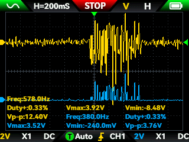

# Rectification

## Objective

This experiment was performed to evaluate the effect of the rectification stage on the EMG signal.

## Measurement setup 

The same electrode configuration described in the [hardware documentation](../../README.md) was used for this experiment.

Channel 1 of the oscilloscope was connected to the node at the diode input, and channel 2 was connected to the node at the diode output.

Measurements were performed during voluntary forearm muscle contraction.

## Experimental conditions

- Prototype: v0.1
- Circuit assembly: breadboard
- Power supply: two 9 V batteries configured as a bipolar supply
- Measurement instrument: FNIRSI 2C53T oscilloscope
- Time scale: 200 ms/div
- Voltage scale: 2 V/div
- Channel coupling: DC (CH1 and CH2)
- Electrode configuration: two recording electrodes + one reference electrode
- Muscle location: forearm
- Number of trials: 5

## Results

| Trial | Before D1 Vmax (V)| Before D1 Vmin (V) | Before D1 Vpp (V) | After D1 Vmax (V) | After D1 Vmin (V) | After D1 Vpp (V) |
|---:|---:|---:|---:|---:|---:|---:|
| 1 | 3.92 | -8.48 | 12.40 | 3.52 | -0.24 | 3.76 |
| 2 | 6.20 | -8.33 | 14.52 | 6.44 | -0.16 | 6.60 |
| 3 | 6.24 | -5.44 | 11.68 | 6.64 | -0.16 | 6.80 |
| 4 | 3.68 | -4.08 | 7.76 | 3.20 | -0.16 | 3.36 |
| 5 | 5.12 | -5.92 | 11.04 | 4.64 | -0.24 | 4.88 |

The mean peak-to-peak voltage was 11.48 V before the diode and 5.08 V after the diode. 

## Experimental observations

Figure 1 shows the oscilloscope measurement during one of the contraction trials.

**Figure 1.** Diode input signal and diode output signal during voluntary forearm muscle contraction.

The oscilloscope shows a bipolar signal before the diode and a unipolar signal after the diode. It can also be observed in the measurements that the Vmin values are close to 0 V after the diode.

During periods of low muscle activity, small fluctuations are visible before the diode, while the signal after the diode appears attenuated and remains close to 0 V.

## Interpretation

The unipolar signal and the Vmin values close to 0 V after the diode indicate that the negative portion of the signal has been substantially suppressed by the half-wave rectification stage.

The attenuation of small signal fluctuations may be related to the forward-voltage threshold of the 1N4007 diode, which can prevent low-amplitude portions of the signal from producing a significant output.

## Limitations

The rectification stage uses a conventional 1N4007 diode, which introduces a forward-voltage threshold that can suppress low-amplitude signal components, particularly during periods of low muscle activity. In addition, the current implementation performs half-wave rather than full-wave rectification, so the negative portion of the signal is discarded.

These limitations should be considered when interpreting the rectified signal and may motivate a future redesign using an active precision rectifier.